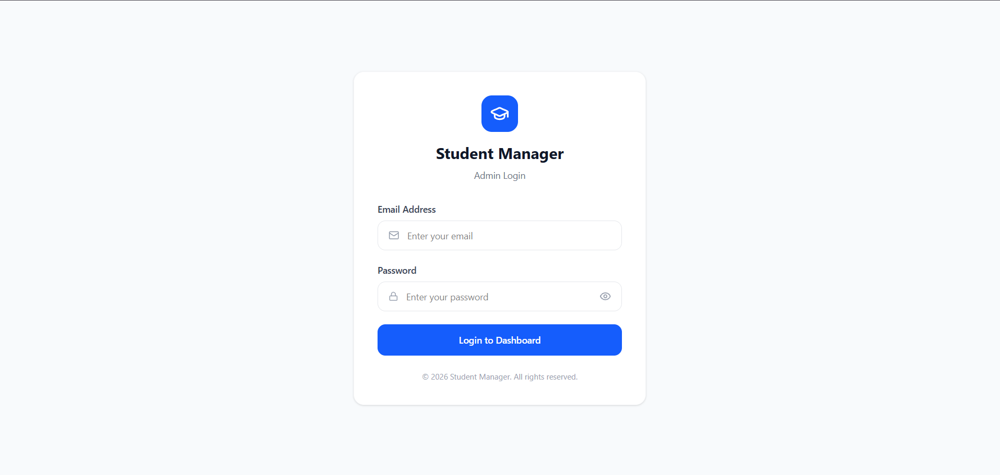

# Student Management Dashboard

A responsive admin dashboard built with **React.js** and **Tailwind CSS** to manage students, courses, and batches. It includes an overview dashboard, searchable management pages, pagination, and browser-based data persistence.

## Live Demo

[Open Student Management Dashboard](https://student-management-dashboard-rouge-six.vercel.app/login)

## GitHub Repository

[View source code](https://github.com/yashsharma2330/student-management-dashboard)

## Screenshots

### Login


### Dashboard


### Students


### Courses


### Batches


## Features

- Admin login page
- Dashboard with summary cards and charts
- Student management: add, view, edit, and delete student records
- Course management: add, view, edit, and delete courses
- Batch management: add, view, edit, and delete batches
- Search and pagination for managing records
- Browser `localStorage` for saving application data
- Admin navigation with React Router
- Reusable UI components
- Confirmation dialogs and alerts using SweetAlert2
- Icons using Lucide React

## Tech Stack

- React.js
- JavaScript
- Tailwind CSS
- React Router DOM
- Vite
- Recharts
- Lucide React
- SweetAlert2
- Browser LocalStorage

## Getting Started

### Prerequisites

Install [Node.js](https://nodejs.org/) and npm.

### 1. Clone the repository

```bash
git clone https://github.com/yashsharma2330/student-management-dashboard.git
```

### 2. Open the project folder

```bash
cd react-project
```

### 3. Install dependencies

```bash
npm install
```

### 4. Start the development server

```bash
npm run dev
```


## Available Scripts

| Command | Description |
| --- | --- |
| `npm run dev` | Starts the local development server |
| `npm run build` | Creates a production build in the `dist` folder |
| `npm run preview` | Previews the production build locally |
| `npm run lint` | Runs ESLint checks |

## Data Storage

This project uses the browser's `localStorage` to save application data. Data is stored locally in the browser on the device where the app is used. It is not stored in a shared cloud database and does not automatically sync between devices or browsers.

## Notes

- This project is intended as a frontend portfolio/demo application.
- Do not add private or real credentials to this public repository.
- The login flow should not be treated as production-grade authentication.

## Author

**Yash Sharma**  
Frontend Developer | BCA Student

---

If you find an issue or have a suggestion, feel free to open an issue in the repository.
