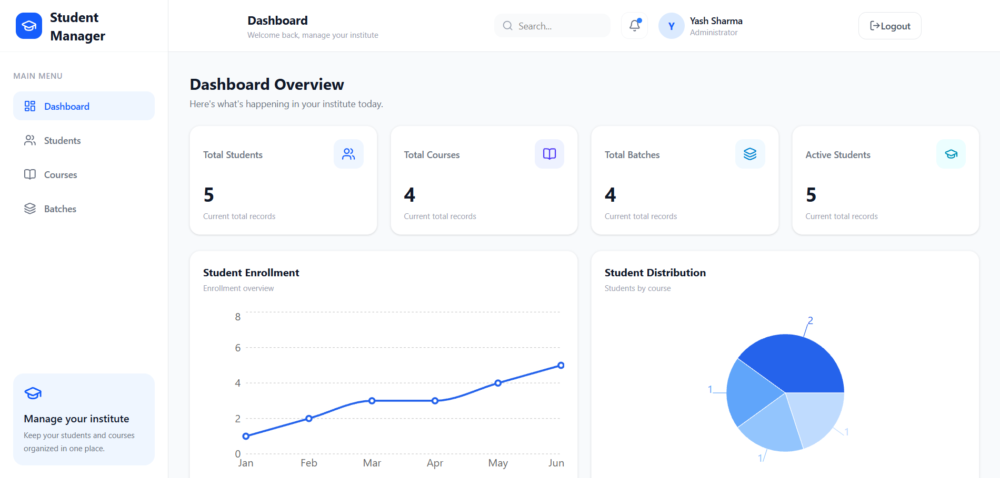
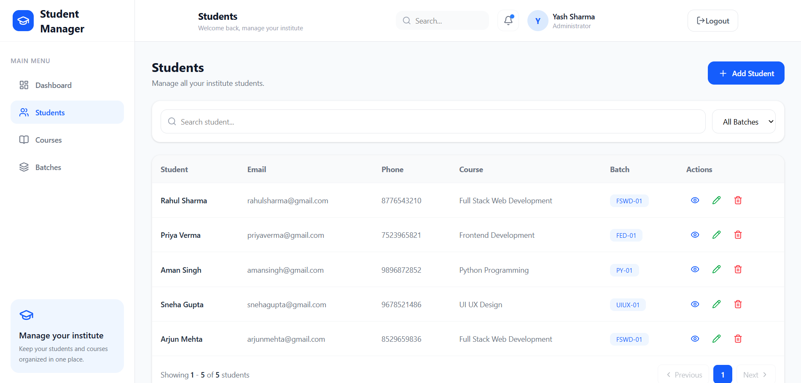
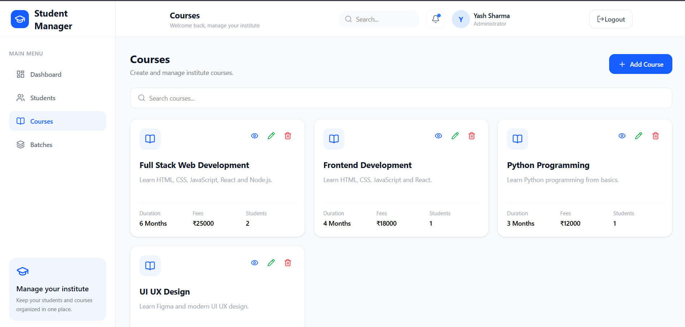
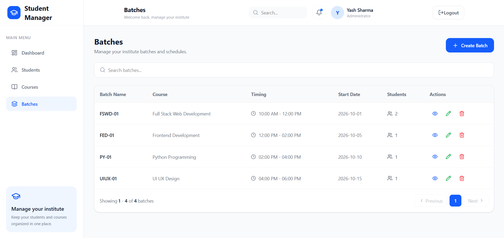

# Student Management Dashboard

A responsive admin dashboard built with **React.js** and **Tailwind
CSS** to manage students, courses, and batches.

## Features

-   Admin dashboard with summary cards and charts
-   Student management: add, view, edit, and delete student records
-   Course management: add, view, edit, and delete courses
-   Batch management: add, view, edit, and delete batches
-   Search and pagination for managing records
-   Client-side data persistence using browser `localStorage`
-   Admin navigation with React Router
-   Reusable UI components
-   Alerts and confirmation dialogs using SweetAlert2
-   Icons using Lucide React

## Tech Stack

-   React.js
-   JavaScript
-   Tailwind CSS
-   React Router DOM
-   Vite
-   Recharts
-   Lucide React
-   SweetAlert2
-   Browser LocalStorage

## Getting Started

### Prerequisites

Install [Node.js](https://nodejs.org/) and npm before running the
project.

### 1. Clone the repository

``` bash
git clone YOUR_GITHUB_REPOSITORY_URL
```

### 2. Open the project folder

``` bash
cd student-management-dashboard
```

### 3. Install dependencies

``` bash
npm install
```

### 4. Start the development server

``` bash
npm run dev
```

Open the local URL shown in your terminal (Vite usually uses
`http://localhost:5173`).

## Available Scripts

  Command             Description
  ------------------- -------------------------------------------------
  `npm run dev`       Starts the local development server
  `npm run build`     Creates a production build in the `dist` folder
  `npm run preview`   Previews the production build locally
  `npm run lint`      Runs ESLint checks

## Data Storage

This project uses the browser's `localStorage` to save application data.
The data is stored locally in the browser on the device where the app is
used. It is not a shared cloud database and does not automatically sync
between devices or browsers.

## Demo Login

If you have configured demo login credentials in the project, add them
here before publishing:

-   **Email:** Add your demo email
-   **Password:** Add your demo password

Do not use real or private credentials in this public README. The demo
login is for demonstration only and is not production-grade
authentication.

## Screenshots

Add screenshots of your dashboard and management pages to a folder such
as `screenshots/`, then update the paths below.

``` md




```

## Live Demo

Add your deployed project URL here after deployment:

**Live Demo:** `YOUR_LIVE_DEMO_URL`

## Author

**Yash Sharma**

Frontend Developer \| BCA Student

------------------------------------------------------------------------

If you find an issue or have a suggestion, feel free to open an issue in
the repository.
